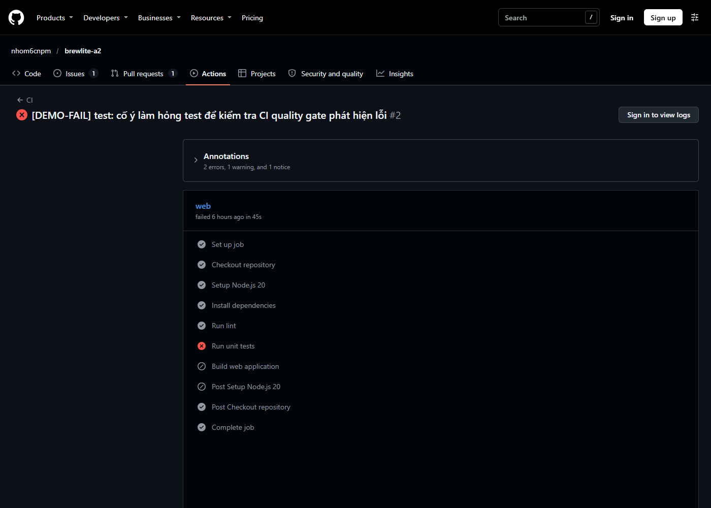

# Minh chứng Continuous Integration (CI) — Task 4.4

Tài liệu lưu trữ minh chứng thực hiện theo yêu cầu Assignment 2 (Task 4.4):
1. **Link 1 Pull Request có CI chạy thành công**.
2. **Ảnh và log 1 lần pipeline phát hiện lỗi** (thực hiện qua PR thử nghiệm cố ý làm hỏng test, ghi nhận phát hiện lỗi và đóng PR).
3. **Minh chứng branch protection khóa nút merge** khi kiểm thử thất bại.

---

## 1. Minh chứng CI chạy thành công
- **Pull Request**: [#24 — ci(web): thiết lập pipeline CI cho web và cấu hình quality gate (Task 4.4)](https://github.com/nhom6cnpm/brewlite-a2/pull/24)
- **Workflow Run**: [GitHub Actions Run #42592007019](https://github.com/nhom6cnpm/brewlite-a2/actions/runs/42592007019)
- **Nhánh thực hiện**: `ci/task-4-4-pipeline` nhắm vào `main`
- **Tệp log console thành công**: [ci-success-log.txt](./ci-success-log.txt)
- **Kết quả quality gate**:
  - **Job `api` (Phúc phụ trách)**:
    - `Checkout repository`: [Success]
    - `Setup Node.js 24` (cache npm): [Success]
    - `Install dependencies` (`npm ci`): [Success]
    - `Run lint` (`npm run lint` — Oxlint `--type-aware`): [Success — 0 errors]
    - `Run unit tests` (`npm test` — Jest): [Success — 2 suites, 8 tests passed]
    - `Build API application` (`npm run build` — NestJS): [Success — production build compiled]
    - **Trạng thái Check `api`**: **Pass (Green checkmark)**
  - **Job `web` (Lương phụ trách)**:
    - `Checkout repository`: [Success]
    - `Setup Node.js 24` (cache npm): [Success]
    - `Install dependencies` (`npm ci`): [Success]
    - `Run lint` (`npm run lint` — ESLint): [Success — 0 errors]
    - `Run unit tests` (`npm test` — Vitest): [Success — 2 test files, 11 tests passed]
    - `Build web application` (`npm run build` — Next.js): [Success — production build compiled]
    - **Trạng thái Check `web`**: **Pass (Green checkmark)**

---

## 2. Minh chứng CI phát hiện lỗi (Quality Gate chặn lỗi)
- **Mục đích**: Kiểm chứng cơ chế bảo vệ của pipeline CI: khi phát hiện vi phạm lint, test hỏng hoặc build lỗi, CI phải dừng ngay lập tức (fail), không cho phép mã nguồn lỗi được merge vào nhánh `main`.
- **Thử nghiệm phát hiện lỗi**: Mở PR [#25 — [DEMO-FAIL] test: cố ý làm hỏng test để kiểm tra CI quality gate phát hiện lỗi](https://github.com/nhom6cnpm/brewlite-a2/pull/25) trên nhánh `test/ci-failure-demo`. Cố ý thêm assertion sai `expect(true).toBe(false)` trong `apps/web/src/app/menu/page.test.tsx`.
- **Workflow Run phát hiện lỗi**: [GitHub Actions Run #42592401582](https://github.com/nhom6cnpm/brewlite-a2/actions/runs/42592401582)
- **Diễn biến lỗi**:
  - `Run lint`: Pass
  - `Run unit tests`: **Fail** (AssertionError: expected true to be false tại `apps/web/src/app/menu/page.test.tsx:14:18`)
  - `Build web application`: **Skipped** (pipeline tự động dừng, không build tiếp khi test hỏng)
  - **Trạng thái Job `web`**: **Failed (Red X)**
- **Tệp log console lỗi**: [ci-failure-log.txt](./ci-failure-log.txt)
- **Ảnh chụp màn hình thực tế từ giao diện GitHub Actions**:
  

- **Xử lý sau thử nghiệm**: PR thử nghiệm #25 đã được đóng sau khi lấy minh chứng.
