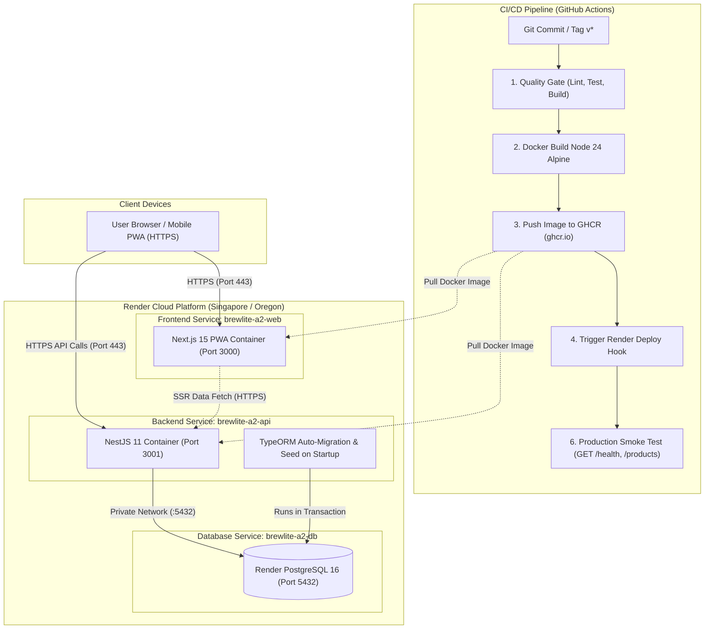

# Tài liệu Triển khai Hệ thống & Continuous Delivery (Deployment Guide)

> **Môn học:** Công nghệ Phần mềm — Trường Đại học Sài Gòn (HK I, 2026–2027)  
> **Dự án:** BrewLite A2 — Ứng dụng đặt đồ uống không dùng tiền mặt  
> **Người thực hiện:** Lương (DevOps & Deployment), Phúc (API & Verification)  
> **Liên quan:** NFR-04, Deployment-01, ADR-008, Task 3.2, Task 5.3, Task 5.4

---

## 1. Nền tảng & Kiến trúc Triển khai Production

Hệ thống **BrewLite A2** được thiết kế để triển khai trên nền tảng đám mây [Render](https://render.com) kết hợp với Container Registry [GitHub Container Registry (ghcr.io)](https://ghcr.io). Mọi dịch vụ web và API đều được phục vụ qua giao thức mã hóa **HTTPS tự động** (Let's Encrypt TLS).

| Thành phần | Dịch vụ Render | URL Production / Endpoint | Ghi chú & Bảo mật |
|---|---|---|---|
| **Frontend Web** (`brewlite-a2-web`) | Web Service | `https://brewlite-a2-web.onrender.com` | Next.js 15 PWA, HTTPS tự động, đóng gói Docker đa tầng từ `ghcr.io`. |
| **Backend API** (`brewlite-a2-api`) | Web Service | `https://brewlite-a2-api.onrender.com` | NestJS 11 REST API, HTTPS tự động, CORS cấu hình tên miền Frontend. |
| **Database** (`brewlite-a2-db`) | Managed PostgreSQL 16 | Private Network (`:5432`) | Kết nối nội bộ qua Private Network giữa API và DB trong cùng Render Region. |
| **Health Check** | API Endpoint | `https://brewlite-a2-api.onrender.com/health` | HTTP 200 `{"status":"ok","database":"up","commit":"..."}`. |
| **Swagger API Docs** | API Interactive UI | `https://brewlite-a2-api.onrender.com/api/docs` | Swagger UI trực quan, hỗ trợ thử nghiệm API kèm Bearer JWT. |
| **OpenAPI Spec** | API Raw JSON | `https://brewlite-a2-api.onrender.com/api/docs-json` | Định nghĩa OpenAPI 3.0 chuẩn cho Postman / công cụ tự động hóa. |

> [!NOTE]
> **Hiện trạng triển khai & Kế hoạch hoàn thiện:**
> - Toàn bộ cấu hình đóng gói Docker Node 24, GHCR registry, CI/CD pipeline, smoke test script và tài liệu hướng dẫn đã được xây dựng và kiểm thử hoàn chỉnh.
> - Các service trên Render (`brewlite-a2-api`, `brewlite-a2-web`, `brewlite-a2-db`) đã được chuẩn bị sẵn sàng. Khi CD pipeline kích hoạt và Render cập nhật image mới từ `ghcr.io`, URL production sẽ chính thức chạy toàn bộ code A2.
> - Việc gắn release tag `v1.0.0` trên GitHub, kiểm định trực tiếp trên URL production, và trích xuất tệp tài liệu `docs/api/openapi.json` (cùng Postman collection) sẽ được hoàn tất sau cùng khi bản A2 đã chạy thật trên Render.

> [!WARNING]
> **Vòng đời Database miễn phí trên Render (30 ngày):**  
> Theo chính sách của Render Free tier, database PostgreSQL miễn phí sẽ tự động hết hạn sau **30 ngày** (kèm 14 ngày gia hạn trước khi bị xóa hoàn toàn).  
> Nhóm tuân thủ đúng khuyến nghị của đề tài: **Khởi tạo database Render sát thời điểm nghiệm thu Task 5**. Đồng thời, hệ thống tích hợp sẵn cơ chế **TypeORM migration tự động chạy khi container API khởi động** (trong migration đã nhúng sẵn dữ liệu mẫu về danh mục, món `p1`..`p6`, công thức nguyên liệu, tài khoản quản trị và voucher), kết hợp tệp sao lưu dữ liệu `pg_dump`. Do đó, nếu database bị xóa hoặc reset, hệ thống có thể **tái lập 100% cấu trúc và dữ liệu chỉ trong vòng dưới 2 phút** mà không cần thao tác thủ công.

---

## 2. Sơ đồ Triển khai (Deployment Diagram)

Hệ thống tuân thủ kiến trúc phân tầng độc lập giữa Presentation Layer (Next.js PWA), Application Service (NestJS API) và Data Persistence (PostgreSQL), kết hợp chu trình tự động hóa qua GitHub Actions và GHCR:



- Xem chi tiết sơ đồ PlantUML và kiến trúc liên quan tại [ADR-008: Nền tảng triển khai](architecture/adr/008-nen-tang-trien-khai.md).

---

## 3. Cấu hình Quyền Container Registry (`ghcr.io`) trên Render

Mặc định, GitHub Container Registry (`ghcr.io`) tạo package ở chế độ **Private**, dẫn đến việc Render không thể kéo image về và báo lỗi `unauthorized: authentication required`. Nhóm cấu hình theo 1 trong 2 cách sau:

### Cách 1: Thiết lập Package sang chế độ Public (Khuyến nghị cho bài tập lớn)
1. Truy cập trang GitHub cá nhân/tổ chức: `https://github.com/orgs/nhom6cnpm/packages` (hoặc mục Packages của tác giả).
2. Chọn từng package: `brewlite-api` và `brewlite-web`.
3. Điều hướng tới **Package settings** → cuộn xuống mục **Danger Zone** → bấm **Change package visibility** → chọn **Public** → gõ xác nhận để lưu.
4. Sau khi chuyển sang Public, Render có thể tự do kéo image theo URL `ghcr.io/nhom6cnpm/brewlite-api:sha-...` mà không cần cấu hình thêm secret.

### Cách 2: Cấu hình Registry Credentials trong Render Dashboard
Nếu giữ package ở chế độ Private:
1. Tạo một GitHub Personal Access Token (Classic) có quyền `read:packages`.
2. Truy cập [Render Dashboard](https://dashboard.render.com) → vào mục **Account Settings** (hoặc Workspace Settings) → chọn **Registry Credentials** → bấm **Add Credential**.
3. Điền thông tin:
   - **Registry:** `ghcr.io`
   - **Username:** Tên tài khoản GitHub (ví dụ: `DucLuong2201`)
   - **Token / Password:** Dán token GitHub vừa tạo.
4. Gán Registry Credential này vào 2 Web Service `brewlite-a2-api` và `brewlite-a2-web`.

---

## 4. Quản lý Biến Môi trường & Bí mật (Secrets)

Toàn bộ bí mật được phân định rõ ràng giữa các giai đoạn: Build time, CI/CD secrets và Runtime secrets trên Render. Tuyệt đối **không commit file `.env` hoặc hardcode secret vào repository**.

### 4.1. Build Arguments (Bắt buộc lúc đóng gói Docker ở CI)
Do Next.js nhúng tĩnh các biến có tiền tố `NEXT_PUBLIC_*` vào mã nguồn client tại thời điểm build (`next build`), các biến này được truyền qua `--build-arg` trong bước đóng gói Docker:

| Build Arg | Giá trị trên Production | Mục đích |
|---|---|---|
| `NEXT_PUBLIC_API_URL` | `https://brewlite-a2-api.onrender.com` | Địa chỉ API để trình duyệt của người dùng gửi yêu cầu HTTP |
| `NEXT_PUBLIC_APP_URL` | `https://brewlite-a2-web.onrender.com` | Địa chỉ gốc của Frontend Web |

### 4.2. GitHub Actions Secrets (Dành cho CI/CD Pipeline)
Cấu hình tại **GitHub Repository → Settings → Secrets and variables → Actions**:

| Tên Secret | Bắt buộc trên `main` | Mô tả |
|---|:---:|---|
| `RENDER_API_DEPLOY_HOOK` | ✅ | Webhook URL kích hoạt Render deploy dịch vụ `brewlite-a2-api` (thiếu secret sẽ dừng pipeline với lỗi exit 1) |
| `RENDER_WEB_DEPLOY_HOOK` | ✅ | Webhook URL kích hoạt Render deploy dịch vụ `brewlite-a2-web` (thiếu secret sẽ dừng pipeline với lỗi exit 1) |
| `PROD_API_URL` | ⬜ | URL API để chạy smoke test (mặc định fallback: `https://brewlite-a2-api.onrender.com`) |
| `PROD_WEB_URL` | ⬜ | URL Web để chạy smoke test (mặc định fallback: `https://brewlite-a2-web.onrender.com`) |
| `GITHUB_TOKEN` | ✅ | Token do GitHub Actions tự động cung cấp có quyền `packages: write` để push image lên GHCR |

### 4.3. Runtime Environment Variables trên Render
Cấu hình tại mục **Environment** của từng dịch vụ trên Render Dashboard:

#### Dịch vụ Backend API (`brewlite-a2-api`)
| Tên Biến | Giá trị Khuyến nghị / Mô tả | Bắt buộc |
|---|---|:---:|
| `NODE_ENV` | `production` | ✅ |
| `PORT` | `3001` (Render tự gán biến `PORT` nội bộ) | ✅ |
| `DATABASE_URL` | Chuỗi kết nối PostgreSQL Render (`postgres://...:5432/...`) | ✅ |
| `JWT_SECRET` | Chuỗi ngẫu nhiên bảo mật (ít nhất 32 ký tự) dùng ký JWT | ✅ |
| `JWT_EXPIRES_IN` | Thời hạn hiệu lực của token (ví dụ: `1d`, `7d`) | ✅ |
| `FRONTEND_URL` | `https://brewlite-a2-web.onrender.com` (cấu hình CORS) | ✅ |
| `ADMIN_EMAIL` | `admin@brewlite.vn` (seed tài khoản quản trị) | ✅ |
| `ADMIN_PASSWORD` | Mật khẩu tài khoản quản trị | ✅ |
| `ORDER_PAYMENT_TIMEOUT_MINUTES` | `15` (thời gian tự hủy đơn chưa thanh toán) | ⬜ |
| `GIT_SHA` | Commit SHA hiện tại (tự động nhúng từ image tag hoặc build arg) | ⬜ |

#### Dịch vụ Frontend Web (`brewlite-a2-web`)
| Tên Biến | Giá trị Khuyến nghị / Mô tả | Bắt buộc |
|---|---|:---:|
| `NODE_ENV` | `production` | ✅ |
| `PORT` | `3000` | ✅ |
| `API_INTERNAL_URL` | `https://brewlite-a2-api.onrender.com` (gọi API từ SSR) | ✅ |

---

## 5. Pipeline Continuous Delivery (Task 5.3)

Quy trình CD được thiết lập tự động hóa hoàn toàn thông qua file workflow [.github/workflows/cd.yml](../.github/workflows/cd.yml), đáp ứng đầy đủ 7 tiêu chuẩn của đề tài:

### 5.1. Chuỗi thực thi 7 chặng chuẩn
1. **Quality Gate:** Tự động chạy lại toàn bộ quy trình kiểm thử chất lượng (`npm ci` → `npm run lint` → `npm test` → `npm run build`) song song cho cả `apps/api` và `apps/web`.
2. **Gắn thẻ Container Image:** Đóng gói Docker image đa tầng dựa trên **Node 24 Alpine** (`node:24-alpine`). Gắn thẻ theo commit SHA (`sha-<short_sha>`, `sha-<long_sha>`), phiên bản ngữ nghĩa (`vX.Y.Z`) và `latest`.
3. **Đẩy lên Registry (GHCR):** Tự động xác thực và đẩy 2 image lên GitHub Container Registry:
   - API: `ghcr.io/nhom6cnpm/brewlite-api`
   - Web: `ghcr.io/nhom6cnpm/brewlite-web` (nhúng tĩnh các biến `NEXT_PUBLIC_*` qua `--build-arg`).
4. **Triển khai Production (Render):** Kích hoạt webhook Render Deploy Hooks bằng secrets an toàn (`RENDER_API_DEPLOY_HOOK`, `RENDER_WEB_DEPLOY_HOOK`). Bắt buộc có secret trên nhánh `main` (nếu thiếu, pipeline dừng với lỗi `exit 1`).
5. **Migration an toàn:** API chạy đơn bản thể (1 replica), TypeORM tự động thực thi các migration mới trong Database Transaction khi khởi động trước khi mở cổng HTTP.
6. **Kiểm thử khói (Smoke Test):** Script [scripts/smoke-test.mjs](../scripts/smoke-test.mjs) kiểm tra thực tế:
   - `GET /health`: Đảm bảo API online, kết nối PostgreSQL lành mạnh, và khớp đúng commit vừa deploy.
   - `GET /products`: Đảm bảo dữ liệu mẫu A2 (`p1`..`p6`) đã sẵn sàng và ORM truy vấn bình thường.
   - `GET /`: Đảm bảo giao diện người dùng Next.js phục vụ bình thường.
   - Hỗ trợ retry backoff (24 lần × 10 giây, tối đa 4 phút) để chờ Render pull image và hoàn tất khởi động.
7. **Dừng pipeline và Rollback:** Nếu smoke test không đạt sau các lần thử, pipeline lập tức dừng lại (đánh dấu thất bại đỏ) và in hướng dẫn rollback chi tiết ra log CI.

### 5.2. Kích hoạt Deploy Hook kèm Image Tag chính xác
Để đảm bảo Render deploy chính xác container image vừa build thay vì image cũ hoặc cache:
- CI gọi webhook kèm tham số truy vấn `imgURL`:
  ```bash
  curl -fsS -X POST "${RENDER_API_DEPLOY_HOOK}&imgURL=ghcr.io/nhom6cnpm/brewlite-api:sha-${SHORT_SHA}"
  curl -fsS -X POST "${RENDER_WEB_DEPLOY_HOOK}&imgURL=ghcr.io/nhom6cnpm/brewlite-web:sha-${SHORT_SHA}"
  ```

### 5.3. Chiến lược kiểm thử phiên bản vừa deploy (Tránh giả xanh)
Trước đây, smoke test chạy ngay khi webhook được gọi có thể kiểm tra trúng bản cũ đang chạy và báo xanh giả tạo. Để giải quyết triệt để:
- Backend nhúng commit SHA vào biến môi trường `GIT_SHA` khi build image. Endpoint `GET /health` trả về `{"status":"ok","commit":"<short_sha>"}`.
- Smoke test script nhận `EXPECTED_COMMIT`. Nếu endpoint phản hồi thiếu commit hoặc commit không trùng khớp, script sẽ tiếp tục retry chờ container mới kích hoạt.
- Nếu chạy workflow thủ công với `skip_deploy: true`, biến `EXPECTED_COMMIT` được để trống nhằm tránh việc test bị fail không cần thiết.

### 5.4. Cơ chế Migration an toàn
- **1 Replica:** Backend API chạy ở chế độ đơn bản thể (1 instance), tránh tranh chấp migration đồng thời.
- **Transaction:** Mỗi migration được bọc trong một Database Transaction độc lập. Nếu xảy ra lỗi, TypeORM tự động rollback và API ngừng khởi động, bảo vệ toàn vẹn dữ liệu.
- **Seed tích hợp:** Dữ liệu mẫu (món `p1`..`p6`, danh mục, công thức kho, voucher) được nhúng sẵn trong migration. Khi khởi động database mới, dữ liệu được nạp tự động mà không cần chạy lệnh thủ công riêng.

---

## 6. Kiểm thử khói sau triển khai (Smoke Test)

Smoke test được thực thi tự động qua script [scripts/smoke-test.mjs](../scripts/smoke-test.mjs) và kiểm định hợp đồng qua [tests/smoke-test.test.mjs](../tests/smoke-test.test.mjs) (`CD-T01`):

| Kiểm tra | Mục tiêu | Tiêu chí chấp nhận |
|---|---|---|
| `GET /health` | Kiểm tra API sống, kết nối PostgreSQL và đúng commit vừa deploy | HTTP 200, JSON `{"status":"ok","commit":"<short_sha>"}` (bắt buộc có commit khi deploy mới) |
| `GET /products` | Kiểm tra dữ liệu sản phẩm chuẩn A2 | HTTP 200, mảng chứa đủ 6 sản phẩm `p1`..`p6` (chặn các ID không chuẩn như dạng số A1 hay chuỗi ngoại lai) |
| `GET /` | Kiểm tra frontend Next.js phục vụ giao diện | HTTP 200, nội dung HTML hợp lệ |

---

## 7. Quy trình Phục hồi & Quay lui (Rollback Plan)

Khi phát hiện sự cố trên production hoặc khi pipeline CD dừng đỏ ở bước smoke test, kỹ sư vận hành áp dụng các phương án rollback sau:

### Phương án 1: Rollback tức thời qua Render Dashboard (Khuyến nghị — Thời gian ≤ 30 giây)
1. Truy cập [Render Dashboard](https://dashboard.render.com).
2. Chọn Web Service bị sự cố (`brewlite-a2-api` hoặc `brewlite-a2-web`).
3. Điều hướng tới tab **Events**.
4. Xác định bản deploy ổn định gần nhất (có nhãn màu xanh lá).
5. Bấm vào nút **Rollback to this deploy**.
6. Render sẽ chuyển traffic về container image của phiên bản ổn định đó mà không cần rebuild.

### Phương án 2: Rollback qua Container Registry Tag (Deploy Hook / Manual Deploy)
Nếu cần rollback về một commit SHA cụ thể trong lịch sử:
1. Xác định commit SHA ổn định trước đó (ví dụ: `sha-3ce74b4`).
2. Kích hoạt Render Deploy Hook trỏ vào image tag tương ứng:
   ```bash
   curl -fsS -X POST "${RENDER_API_DEPLOY_HOOK}&imgURL=ghcr.io/nhom6cnpm/brewlite-api:sha-3ce74b4"
   curl -fsS -X POST "${RENDER_WEB_DEPLOY_HOOK}&imgURL=ghcr.io/nhom6cnpm/brewlite-web:sha-3ce74b4"
   ```
   Hoặc trên Render Dashboard: **Settings** → Cập nhật **Image URL** về tag ổn định → bấm **Manual Deploy**.

### Phương án 3: Rollback cấu trúc Database (nếu migration gây lỗi)
Nếu phiên bản mới đã áp dụng một migration sai lệch cấu trúc dữ liệu:
1. Kết nối vào database qua Render Shell hoặc máy local có kết nối tới `DATABASE_URL`:
   ```bash
   cd apps/api
   npm run migration:revert
   ```
2. TypeORM sẽ thực thi hàm `down()` của migration gần nhất để khôi phục cấu trúc bảng về trạng thái trước đó.

---

## 8. Kế hoạch Quản lý Database Render (Hạn mức 30 ngày)

Để đảm bảo hệ thống luôn sẵn sàng phục vụ việc chấm điểm mà không bị ảnh hưởng bởi chính sách xóa database miễn phí sau 30 ngày của Render:

1. **Khởi tạo muộn nhất có thể:** Chỉ tạo instance PostgreSQL trên Render trước mốc nghiệm thu Sprint 2 / Task 5 từ 3–5 ngày.
2. **Kịch bản phục hồi thảm họa trong 2 phút:**
   - Toàn bộ bảng dữ liệu, khóa ngoại, chỉ mục và dữ liệu mẫu đều được quản lý 100% bằng mã nguồn TypeORM Migration trong `apps/api/src/migrations/`.
   - Khi database hết hạn hoặc bị reset: Chỉ cần tạo database mới trên Render → copy chuỗi kết nối vào biến `DATABASE_URL` của `brewlite-a2-api` → API khởi động sẽ tự động dựng lại toàn bộ cấu trúc và nạp đầy đủ dữ liệu mẫu hoàn chỉnh.

---

## 9. Hướng dẫn Thử nghiệm API & Nghiệm thu Hệ thống Production

### 9.1. Kiểm tra Trực tiếp qua Trình duyệt & API Endpoint

| Dịch vụ | Đường dẫn kiểm tra | Kết quả mong đợi |
|---|---|---|
| **API Healthcheck** | `https://brewlite-a2-api.onrender.com/health` | HTTP 200, JSON: `{"status":"ok","database":"up","commit":"..."}` |
| **API Danh mục món** | `https://brewlite-a2-api.onrender.com/products` | HTTP 200, danh sách mảng JSON chứa 6 sản phẩm chuẩn A2 (`p1`..`p6`) |
| **Swagger UI** | `https://brewlite-a2-api.onrender.com/api/docs` | Giao diện tương tác Swagger UI hiển thị đầy đủ tài liệu API |
| **OpenAPI Spec** | `https://brewlite-a2-api.onrender.com/api/docs-json` | Tệp JSON đặc tả OpenAPI 3.0 hoàn chỉnh |
| **Giao diện Web** | `https://brewlite-a2-web.onrender.com` | Trang chủ BrewLite hiển thị menu thức uống, PWA header, giỏ hàng |

### 9.2. Hướng dẫn Thử nghiệm API trên Swagger Production

1. Truy cập trang Swagger UI tại: [https://brewlite-a2-api.onrender.com/api/docs](https://brewlite-a2-api.onrender.com/api/docs)
2. **Đăng nhập lấy Token:**
   - Mở nhóm API **Auth** → chọn `POST /auth/login`.
   - Bấm **Try it out**, điền thông tin đăng nhập:
     ```json
     {
       "email": "customer@brewlite.vn",
       "password": "Password123!"
     }
     ```
     *(Hoặc tài khoản admin: `admin@brewlite.vn` / mật khẩu quản trị).*
   - Bấm **Execute**, copy chuỗi `access_token` trong phản hồi.
3. **Ủy quyền (Authorize):**
   - Cuộn lên đầu trang Swagger, bấm nút **Authorize** (biểu tượng ổ khóa màu xanh).
   - Nhập chuỗi token vừa copy vào ô **Value** → bấm **Authorize** → **Close**.
4. **Thực thi các API yêu cầu xác thực:**
   - Có thể thử nghiệm trực tiếp các API bảo mật như `GET /auth/me`, `POST /orders`, `GET /vouchers`, `GET /admin/orders`... ngay trên trình duyệt mà không bị lỗi `401 Unauthorized`.

---

## 10. Bàn giao & Vận hành

- **Mã nguồn Repository:** `https://github.com/nhom6cnpm/brewlite-a2`
- **Tài liệu Kiến trúc & ADR:** Thư mục [docs/architecture/](architecture/) và [docs/traceability-matrix.md](traceability-matrix.md).
- **Kiểm thử Tự động:**
  - Unit tests: `npm test` trong từng thư mục `apps/api` và `apps/web`.
  - Integration tests: `npm run test:integration` trong `apps/api` (kết nối PostgreSQL thật).
  - Smoke tests: `node --test tests/smoke-test.test.mjs`.
