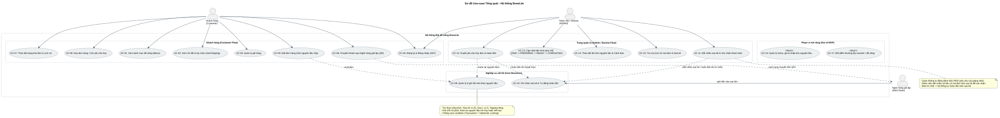

# Task 1.2 – Đặc tả yêu cầu phần mềm (SRS rút gọn)

Mức ưu tiên theo **MoSCoW**: Must / Should / Could / Won't.
Tiêu chí chấp nhận phải **kiểm chứng được** để dùng viết test ở các task sau.

## 1. Yêu cầu chức năng (Functional Requirements)
<!-- Nhóm tối thiểu: menu, chi tiết sản phẩm, giỏ hàng, xác thực, đặt đơn,
     thanh toán, lịch sử đơn, quản lý trạng thái đơn -->

| Mã | Nhóm | Mô tả | Ưu tiên | Tiêu chí chấp nhận |
|---|---|---|---|---|
| FR-01 | Menu | | | |
| FR-02 | Chi tiết sản phẩm | | | |
| FR-03 | Giỏ hàng | | | |
| FR-04 | Xác thực | | | |
| FR-05 | Đặt đơn | | | |
| FR-06 | Thanh toán | | | |
| FR-07 | Lịch sử đơn | | | |
| FR-08 | Quản lý trạng thái đơn | | | |

## 2. Yêu cầu phi chức năng (Non-functional Requirements)
<!-- Nhóm tối thiểu: hiệu năng, bảo mật, tính khả dụng, khả năng triển khai -->

| Mã | Nhóm | Mô tả | Ưu tiên | Tiêu chí chấp nhận |
|---|---|---|---|---|
| NFR-01 | Hiệu năng | | | |
| NFR-02 | Bảo mật | | | |
| NFR-03 | Tính khả dụng | | | |
| NFR-04 | Khả năng triển khai | | | |

## 3. Sơ đồ use-case tổng quát
Nguồn: `docs/diagrams/usecase-overview.puml` – Ảnh: `docs/diagrams/usecase-overview.svg`

<!--  -->
